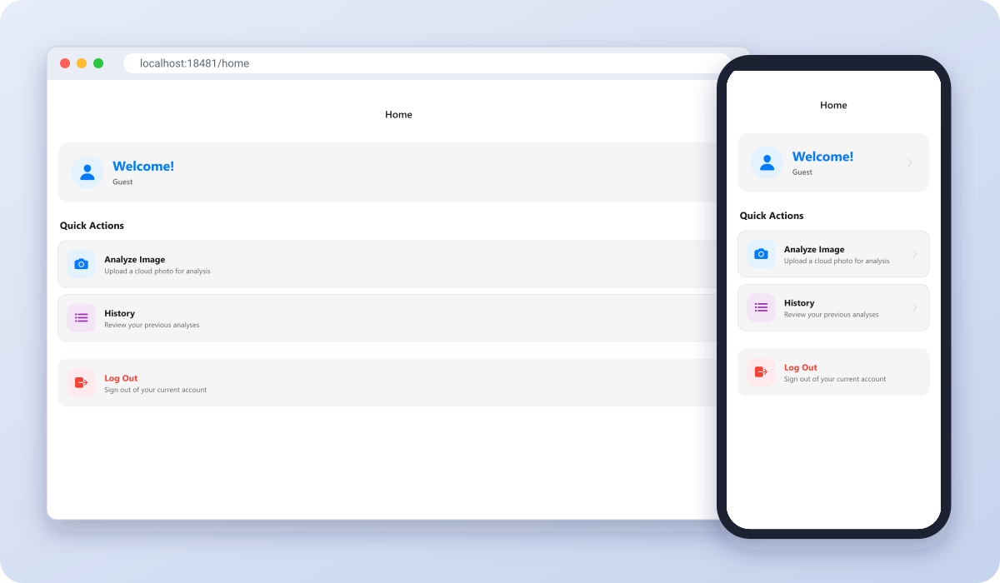

# giise2ebench-st-climanuvem

<p align="center"></p>

## Deployment

The SUT lives in [`sut/`](sut/). Backend services are defined in [`sut/backend/docker-compose.yml`](sut/backend/docker-compose.yml) (production layout); [`docker-compose.dev.override.yml`](sut/backend/docker-compose.dev.override.yml) overrides only what changes in development.

### Production (real Firebase project)

1. In the [Firebase console](https://console.firebase.google.com/) create a project and enable **Authentication** (Email/Password, Google and Anonymous providers).
2. **Backend credentials**: *Project settings → Service accounts → Generate new private key*, and save it as `sut/backend/secrets/firebase_key.json`.
3. **Frontend config**: *Project settings → General → Your apps* — register a web app and copy its values into `sut/frontend/.env`; register an Android app and save `google-services.json` as `sut/frontend/google-services.json`.
4. Create `sut/backend/.env` (used by Compose):

   ```env
   POSTGRES_USER=climanuvem
   POSTGRES_PASSWORD=<strong password>
   POSTGRES_DB=climanuvem
   OLLAMA_MODEL=gemma4:e4b
   ```

5. Create `sut/frontend/.env`:

   ```env
   EXPO_PUBLIC_BACKEND_URL=https://<your-backend-host>
   EXPO_PUBLIC_TEST_MODE=false
   EXPO_PUBLIC_DEFAULT_LANGUAGE=es
   EXPO_PUBLIC_FIREBASE_API_KEY=...
   EXPO_PUBLIC_FIREBASE_AUTH_DOMAIN=...
   EXPO_PUBLIC_FIREBASE_PROJECT_ID=...
   EXPO_PUBLIC_FIREBASE_STORAGE_BUCKET=...
   EXPO_PUBLIC_FIREBASE_MESSAGING_SENDER_ID=...
   EXPO_PUBLIC_FIREBASE_APP_ID=...
   EXPO_PUBLIC_FIREBASE_MEASUREMENT_ID=...
   ```

6. Start the backend (PostgreSQL, Ollama with GPU, FastAPI on `:8000`):

   ```bash
   cd sut/backend
   docker compose up --build -d
   ```

7. Run the frontend (`cd sut/frontend && npm ci && npm start`) or build the Android APK (see [`sut/README.md`](sut/README.md)).

`secrets/`, `.env` and `google-services.json` are git-ignored; never commit them.

### Development (Firebase Auth emulator)

No Firebase project, service account or `google-services.json` is needed: the override adds a local [Firebase Auth emulator](https://firebase.google.com/docs/emulator-suite) and a web frontend, and points the backend at it.

```bash
cd sut/backend
printf 'POSTGRES_USER=climanuvem\nPOSTGRES_PASSWORD=climanuvem\nPOSTGRES_DB=climanuvem\nOLLAMA_MODEL=gemma4:e4b\n' > .env
docker compose -f docker-compose.yml -f docker-compose.dev.override.yml up --build
```

| Service | URL |
|---|---|
| Backend (FastAPI) | http://localhost:8000 |
| Frontend (Expo web) | http://localhost:8081 |
| Firebase Auth emulator | http://localhost:9099 |
| Emulator UI (users, verification links) | http://localhost:4000 |

What the override changes: the `firebase-emulator` service is added; the backend runs with `FIREBASE_AUTH_EMULATOR_HOST` (no `firebase_key.json`) and `FIREBASE_PROJECT_ID=demo-climanuvem`; the frontend gets `EXPO_PUBLIC_FIREBASE_AUTH_EMULATOR_URL`. Emulator users are lost when the container is removed. Registration emails are not sent: open the UI at `:4000` to find the verification link, or mark the account as verified there.

To run the Expo dev server outside Docker, set `EXPO_PUBLIC_FIREBASE_AUTH_EMULATOR_URL=http://localhost:9099` and the demo values above in `sut/frontend/.env`.

### System tests

[`selenium-java/`](selenium-java/) and [`cypress-js/`](cypress-js/) run against the same stack (base + dev override + a test override) with the emulator; see their READMEs.

---

<p align="center">
  <a href="https://giis.uniovi.es/"></a>
</p>
